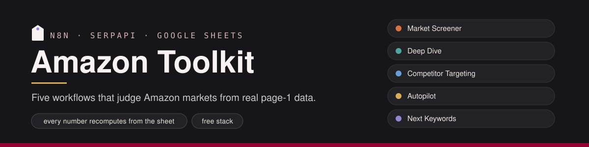
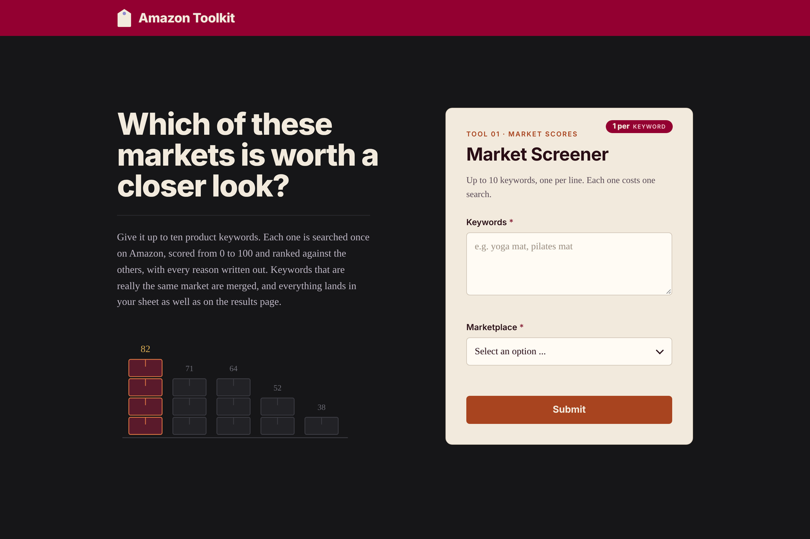
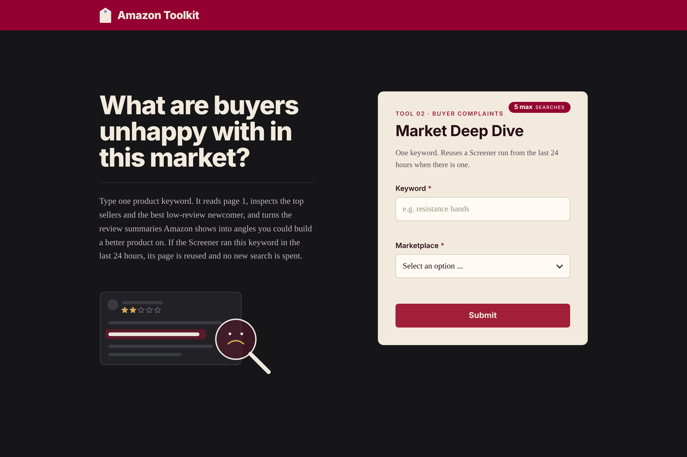
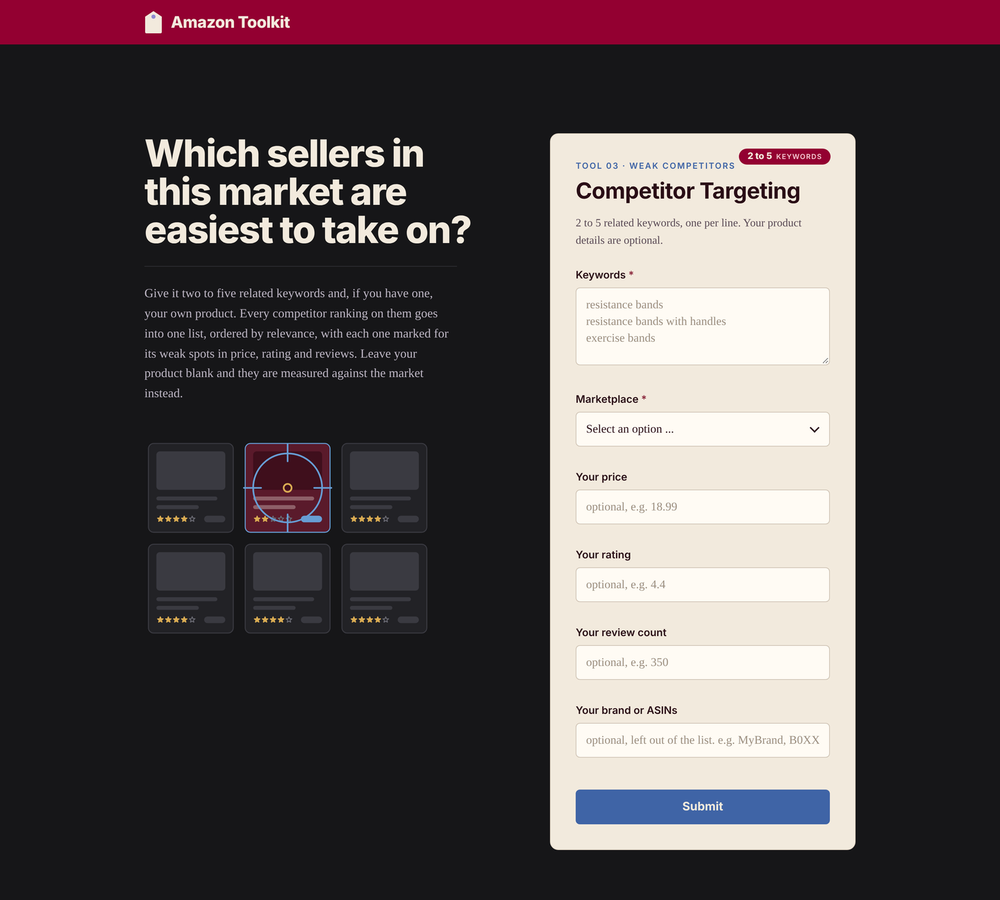
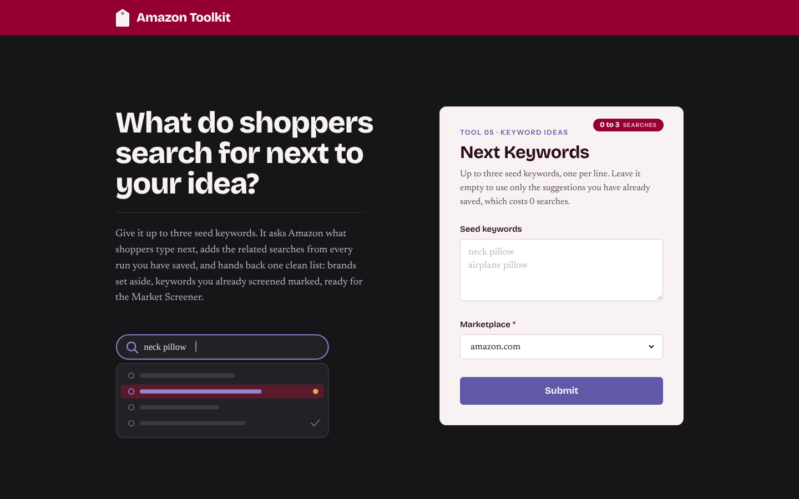
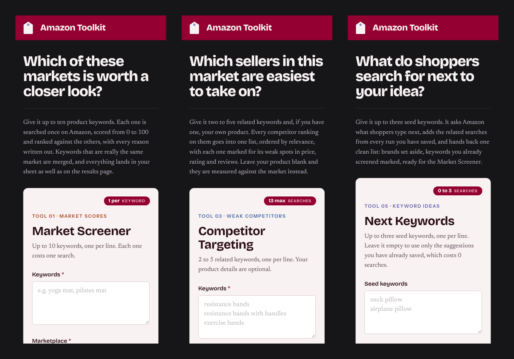
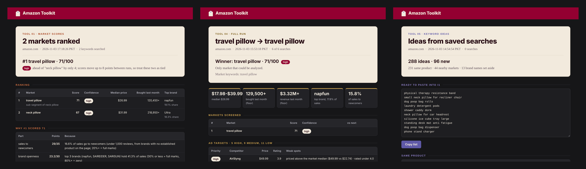
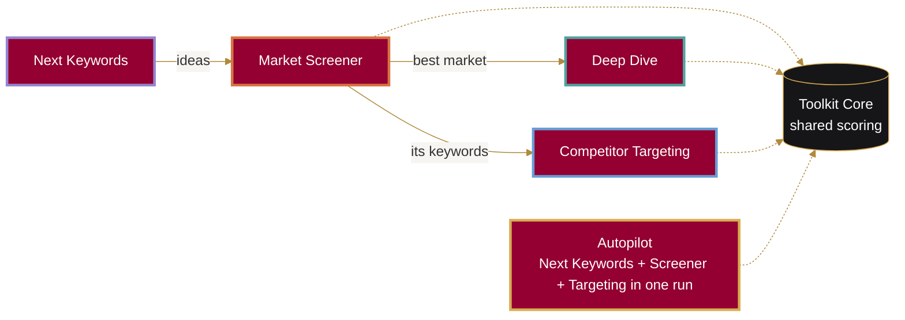

Five n8n workflows that answer the questions a new Amazon seller asks before spending money: *which market, how crowded is it, and who should I aim my ads at?* They answer them from Amazon's own page 1: prices, reviews, ratings and "bought in past month" badges. The answers are written to a Google Sheet, where every number can be recomputed from the listings behind it.

## The tools

| | Tool | You give it | You get | Searches |
|---|---|---|---|---|
|  | [**Market Screener**](i1-market-screener/README.md) | up to 10 keywords | markets ranked 0–100, variants merged, reasons written out | 1 per keyword |
|  | [**Deep Dive**](i2-market-deep-dive/README.md) | 1 keyword | top sellers looked up, review complaints turned into product angles | up to 5 |
|  | [**Competitor Targeting**](i3-competitor-targeting/README.md) | 2–5 keywords + your product | every page-1 competitor ranked and judged as an ad target | up to 13 |
|  | [**Autopilot**](i4-market-autopilot/README.md) | 1 seed keyword | ideas → screened markets → winner → ad targets, in one emailed report | up to 20 |
|  | [**Next Keywords**](i5-next-keywords/README.md) | up to 3 seeds, or none | fresh keyword ideas, grouped and ready to paste into the Screener | 1 per seed |

A page or product looked up in the last 24 hours is reused by every tool for 0 searches, so running Deep Dive or Competitor Targeting right after Autopilot is mostly free.

## What it looks like

Every tool opens with its own form: the same charcoal page and rose-white card, a different colour and illustration per tool.

<table>
<tr><td></td><td></td></tr>
<tr><td></td><td></td></tr>
<tr><td></td><td></td></tr>
</table>

What comes back: a result page for every run, rendered from the same rows that land in the sheet (real runs, 3 Nov 2026).



## How they fit together



Two support workflows sit underneath:
- **Toolkit Core** (`c1`) is the shared analysis: grouping variations, scoring, stability and merging variants. Every tool that reads a search page calls it, so a market scores the same whichever tool looks at it.
- **Error Alerts** (`e0`) emails you when any tool fails.

The short codes (i1 to i5, c1, e0) name the folders, the workflow files and the workflows inside n8n (`i1. market-screener`), and fill the `tool` column in the sheet: i1 Market Screener, i2 Deep Dive, i3 Competitor Targeting, i4 Autopilot, i5 Next Keywords.

## Rules every tool follows

- **AI never writes a number.** Only Deep Dive uses AI, and only to suggest product angles from review themes. Code writes every figure, and anything the AI returns with a digit in it is dropped.
- **Sales are floors.** "1K+ bought in past month" counts as 1,000. Sales are never added up across keywords, because the same product shows up on several pages.
- **Evidence first.** Listings are saved before any summary row, so no score exists without the page behind it.
- **Reasons are written out.** Every score has its breakdown, and every confidence level says what lowered it.
- **A brand name describes a brand, not a market.** Brand keywords are set aside, not screened.
- **Nothing is paid for twice.** Pages and lookups are reused for 24 hours, and failed keywords are skipped for 24 hours.
- **One scale for every marketplace.** The price and demand thresholds are in US dollars, so amazon.co.uk and amazon.ca prices are converted first: £1 = $1.32 and C$1 = $0.70 (fixed rates from 2 Oct 2026). The same products score the same on any marketplace.

## The sheet

One Google Sheet holds everything. Each tool writes with *append or update* on `row_id`, so re-running never duplicates rows.

| Tab | Written by | One row is |
|---|---|---|
| **Listings** | Screener, Deep Dive, Targeting, Autopilot | one listing on one search page: the evidence |
| **Products** | Deep Dive, Targeting, Autopilot | one product page lookup (BSR, seller, real brand, review themes) |
| **Keywords** | Screener, Targeting, Autopilot | one keyword's page-1 statistics |
| **Markets** | Screener, Autopilot | one market (merged keywords) with its score and reasons |
| **Deep Dive** | Deep Dive | one deep dive: evidence table and angles |
| **Targets** | Targeting, Autopilot | one competitor judged as an ad target |
| **Target Runs** | Targeting | one targeting run |
| **Autopilot Runs** | Autopilot | one Autopilot report |
| **Keyword Ideas** | Next Keywords | one keyword idea |
| **Idea Runs** | Next Keywords | one ideas run |

Times: `checked_at` in Listings, Keywords, Markets and Deep Dive is **UTC**, SerpApi's own time for when the page was fetched. Run times (`batch_id`, and `checked_at` in the run tabs) are **Pakistan time**, ending in `PKT`. Each header carries a note saying which.

The header row for every tab is in [`sheet/headers.txt`](sheet/headers.txt). [`sheet/format_toolkit.gs`](sheet/format_toolkit.gs) is an Apps Script that applies the colours, number formats and status highlights. Run it once from **Extensions → Apps Script**.

## Free stack, honest costs

| Piece | Used for | Cost |
|---|---|---|
| n8n Community Edition (self-hosted, Docker) | the workflows | free |
| SerpApi free tier | Amazon search pages, product pages, autocomplete | 250 searches/month |
| Google Sheets | storage and the readable output | free |
| OpenRouter free models | Deep Dive's angles only | free |
| Gmail SMTP | Autopilot report, error alerts | free |

On the free tier, one full Autopilot run can use 20 of the 250 monthly searches. Real client use would mean a paid SerpApi plan.

## Tested and rejected

**Google Trends as a demand check.** It was tested with 2 searches and dropped:
- Long-tail keywords returned zeros.
- `kitchen sponges` showed close to 0 on Google while its Amazon page 1 showed 464,500+ units bought last month.
- Unrelated keywords showed the same synchronized spike from 22 Mar to 16 May 2026, which points to a data artifact rather than demand.

Amazon's own badges measure Amazon demand better than Google does.

## Setup order

1. Make the Google Sheet with the tabs and headers above.
2. Import **Error Alerts** (`e0-error-alerts.json`), set its SMTP credential, and replace `you@example.com` with your own From and To addresses.
3. Import **Toolkit Core** (`c1-toolkit-core.json`).
4. Import the tools you want. In each one, pick your credentials, point every Google Sheets node at your own sheet (the exports say `YOUR_SHEET_ID`), point its **Toolkit Core** node at `c1. toolkit-core`, and set **Settings → Error workflow** to `e0. error-alerts`.
5. Run n8n with `N8N_CONCURRENCY_PRODUCTION_LIMIT=1` so runs queue instead of colliding.
6. Keep every form behind a sign-in. The exports already set each form node's **Authentication** to n8n User Auth, so only people signed in to your n8n can open them. For someone without an n8n account, switch that form to Basic Auth instead. A public form URL lets anyone spend your SerpApi searches.
7. **Save** and **Publish** each workflow. Forms run the published version.

Each tool's README has its own steps.

## Repository

```
├── README.md                     this page
├── assets/                       banners and images
├── sheet/                        tab headers + formatting script
├── c1-toolkit-core/              shared analysis (sub-workflow): README + .json
├── e0-error-alerts/              failure emails: README + .json
├── i1-market-screener/           README + workflow .json
├── i2-market-deep-dive/
├── i3-competitor-targeting/
├── i4-market-autopilot/
├── i5-next-keywords/
├── tests/                        runs the workflows' own code outside n8n
└── LICENSE
```

## Tests

[`tests/`](tests/README.md) runs every Code node's JavaScript outside n8n, unchanged, against generated Amazon pages, so no searches are spent. It covers:

- a 400-page fuzz of the core: every score stays within 0–100, with no blank or broken values
- the same input always giving the same output
- HTML escaping on every result page and email
- searches counted against searches made
- the AI checks in Deep Dive
- one regression check for each bug found in review
- a break test: 8 targeted attacks and a fuzzer that throws hostile Amazon pages and form input at the tools ([what it found](tests/BREAK-TEST.md))

`node tests/t4_regressions.js` and `node tests/t5_attacks.js` exit with an error while any of those bugs is back.
