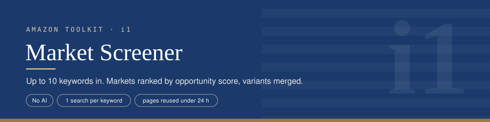
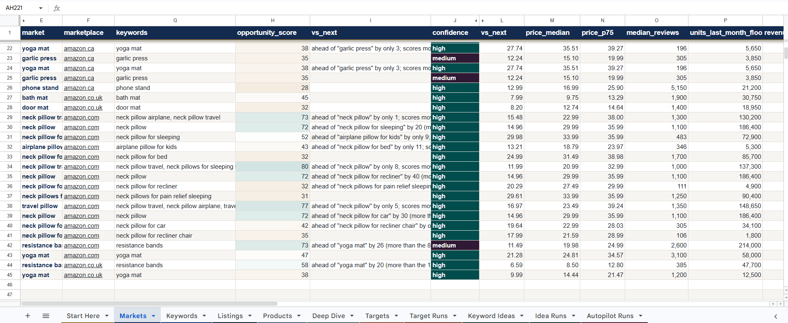

<p align="center">
<a href="../README.md">Toolkit</a> ·
<b>i1 Screener</b> ·
<a href="../i2-market-deep-dive/README.md">i2 Deep Dive</a> ·
<a href="../i3-competitor-targeting/README.md">i3 Targeting</a> ·
<a href="../i4-market-autopilot/README.md">i4 Autopilot</a> ·
<a href="../i5-next-keywords/README.md">i5 Next Keywords</a>
</p>

## What it does

You paste up to 10 keywords and pick a marketplace (amazon.com, .co.uk or .ca). For each keyword the Screener reads Amazon's page 1 and works out four things: who sells, how much, at what price, and against how many reviews. It then ranks the keywords as markets from 0 to 100 and writes out why each one scored what it did.

Keywords that are really the same market, like `resistance band` and `resistance bands`, are merged into one, and the differences between them are shown.

No AI is involved. The results go to the **Markets** and **Keywords** tabs, and every listing behind them goes to **Listings**.

## What it replaces

| By hand | Screener |
|---|---|
| Search each keyword on Amazon, scroll page 1 | 1 search per keyword |
| Count reviews, note prices, guess who dominates | Prices, review moat, brand shares and newcomer sales measured per keyword |
| Notice that two keywords show the same products | Keywords sharing 70%+ of their sales merged into one market |
| Rank by gut feeling | Score 0–100 with the breakdown written out, and a warning when two scores are too close to call |

## How it works


**1. Search.** One SerpApi search per keyword. Anything over 10 keywords is skipped and written to the sheet as "run it in the next batch", never silently dropped.

**2. History.** The Listings tab is read once, so each keyword can be compared with its previous run (stability).

**3. Core (`c1 · toolkit-core`).** This is the shared analysis every tool uses.
- **Clean.** Listings without the product word in the title, accessories, bulk packs and price outliers are set aside, each with its reason written in Listings.
- **Group.** Variations of one product share a review count, so they are grouped and counted once.
- **Score** from 0 to 100:

| Part | Weight | Full marks when |
|---|---|---|
| Sales to newcomers (under 1,000 reviews, from brands with no established product on the page) | 35 | 20%+ of page-1 sales |
| Brand openness (top 3 brands' share of sales) | 30 | 30% or less (80%+ = zero) |
| Review moat (median product's reviews) | 25 | 1,000 or less (31,600+ = zero) |
| Price room (median price) | 10 | $20+ ($8 or less = zero) |
| × Demand (page-1 revenue, badge floors) | multiplier | $10M+/month = ×1.0, $10K or less = ×0.2 |

Price room and demand are judged in US dollars. amazon.co.uk and amazon.ca prices are converted first (£1 = $1.32, C$1 = $0.70, fixed rates from 2 Oct 2026), so the same products score the same on every marketplace (core v2.6).

- **Confidence** (high, medium or low) drops for a sale event, a thin page, missing sales data, a weak keyword match, or mostly unknown brands. Each drop is written out.
- **Stability.** The share of sales sitting on products that were also on page 1 last time. If SerpApi served a cached copy (it caches identical searches for 1 hour), the row says so instead of pretending it's a new measurement.
- **Ranking.** Each market says how far ahead of the next one it is, and whether that gap is bigger than run-to-run noise (3 points for a stable market, 8 for moderate, 12 for unstable or first-run).

**4. Evidence first.** Listings are saved before any summary, so no score exists without the page behind it.

## What it handles

| Situation | What happens |
|---|---|
| More than 10 keywords | The extra ones get a `skipped` row: "Over the 10-keyword limit per run" |
| A keyword with no usable listings (typo, nonsense) | A `failed` row with the reason; the other keywords carry on |
| A page with too few usable listings | Stops that keyword and names the word to drop ("try the keyword without it") |
| Same keyword re-run within the hour | Detected as SerpApi's cached copy, marked `cached copy`, not a new measurement |
| Plural and singular forms | Merged as one market, with what each one shows on its own |
| A brand's own new listing under 1,000 reviews | Not counted as a newcomer (fixed after Lodge's own skillets lifted "cast iron skillet") |
| Real products named differently ("Dawn" for dish soap) | If they hold 15%+ of page-1 sales, the score they would give is shown next to the real one |
| Two runs at once | Queued by n8n, no rows lost |

## How it was tested

- **Live batches** on amazon.com, amazon.co.uk and amazon.ca, 16–17 Oct 2026: 10-keyword batches, merged variants, a deliberate nonsense keyword (`xqzvbnmplk`), an 11th keyword over the limit, and a re-run inside SerpApi's 1-hour cache.
- **Stability measured live:** `resistance band` re-run 15 hours later kept 98.1% of its sales on the same products. Its score moved by 1 point.
- **Currency checked live (core v2.6), 18 Oct 2026:** an amazon.co.uk batch scored `resistance bands` 58 and `yoga mat` 38. Every part was recomputed by hand from the row, including the £ → $ conversion. Before v2.6, both scored about 4 points lower because pounds were read as dollars.
- **The scoring changed because of live results, and each change is in the code comments:**
  - `bonsai tools` scored 81 in v2.0 with only ~$50K a month of sales on page 1. Demand became a multiplier, so a market nobody buys from can't top the list.
  - One brand at 31% looked "open" while three brands held 82%. Brand openness now uses the top 3 brands.
  - The "named differently" check was run on 15 markets. The tier never changed, and the score moved 0–5 points.

## Sample output

Two runs, both in the screenshot below.

**amazon.com, 17 Oct 2026.** Both keywords had been checked before, so stability is measured.

| # | Market | Score | Confidence | Stability | Median price | Bought last month (floor) | Top 3 brands hold | vs next |
|---|---|---|---|---|---|---|---|---|
| 1 | resistance bands | **73** | medium | stable | $19.98 | 214,000+ | 16.8% | ahead by 26 |
| 2 | yoga mat | 47 | high | moderate | $24.81 | 58,000+ | 54.7% | |

**Why #1 scored 73**, as written in the sheet:

```
low_review_sales 25.8/35  14.8% of sales go to newcomers
brand_openness   30/30    top 3 brands (Fit, WHATAFIT, HPYGN) hold 16.8% of sales
review_moat      18.1/25  median product has 2,600 reviews
price_room       10/10    median price $19.98
openness 83.9/100 x demand 0.87  (at least $3.34M in sales last month on page 1)
```

Confidence is medium for one reason, also written in the row: "brand unknown for 72% of sales (titles start with generic words), so brand_openness is unverified". `Fit` is a title guess for Fit Simplify (see the limitations below).

**amazon.co.uk, 18 Oct 2026, core v2.6.** Prices are in pounds and converted to dollars before scoring.

| # | Market | Score | Confidence | Stability | Median price | Bought last month (floor) | Top 3 brands hold | vs next |
|---|---|---|---|---|---|---|---|---|
| 1 | resistance bands | **58** | high | first run | £8.50 | 47,700+ | 39.2% | ahead by 20 |
| 2 | yoga mat | 38 | high | stable | £14.44 | 12,500+ | 48% | |

Same product, different market. On amazon.co.uk, newcomers take 39.3% of resistance band sales (full marks), but a median price of £8.50 (about $11) leaves little room, so `price_room` gets 2.7 of 10 and the score lands at 58.


*The Markets tab, with rows from several runs. The amazon.ca and amazon.co.uk rows from 17 Oct were scored before core v2.6, when local prices were still read as dollars. The repeated amazon.ca pair is a re-run inside SerpApi's 1-hour cache, marked `cached copy`.*

## Setup

1. Have the toolkit sheet, `c1 · toolkit-core` and `e0 · error-alerts` ready (see the [toolkit README](../README.md#setup-order)).
2. **Workflows → ⋯ → Import from File** → `i1-market-screener.json`.
3. **Search Amazon (SerpApi)** → your SerpApi credential. **Read History**, **Save Listings**, **Save Keywords** and **Save Markets** → your Google credential and the toolkit sheet.
4. **Toolkit Core** → `c1 · toolkit-core`. **⋯ → Settings → Error workflow** → `e0 · error-alerts`.
5. **Save**, then **Publish**. Open the form node and copy its Production URL.

## Known limitations

- **Sales are floors** from Amazon's "bought in past month" badges, never estimates. Badges are rarer on amazon.ca, so its markets look smaller.
- **No search volume, fees, profit, trend or product age.** Every Markets row lists these under `cannot_tell`.
- **Brands are guessed from titles.** `top_brand` can be a generic first word (`Kitchen`, `Ultra`). i3 and i4 correct this for their targets; this tab does not.
- **One snapshot.** A first run has no stability measure, so its noise band is the widest (12 points).
- **Thin pages** (under 30 listings) lower confidence.
- **Exchange rates are fixed,** so UK and Canadian scores drift slightly as real rates move. They are set at the top of the core and should be updated a few times a year.
- **The weights are a judgement call.** They're written out so they can be argued with, and changing them means editing the core.
