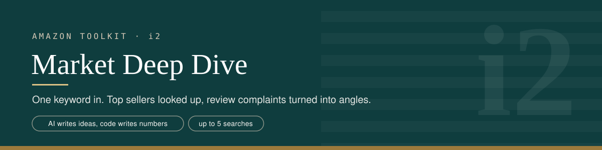
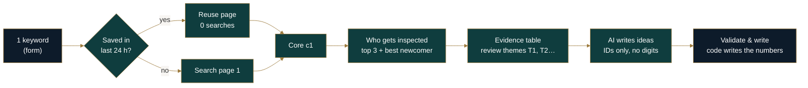
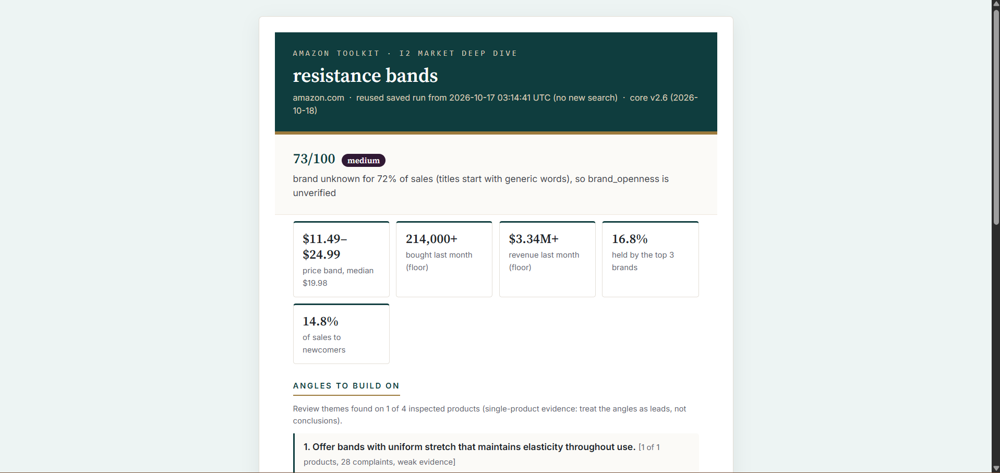

<p align="center">
<a href="../README.md">Toolkit</a> ·
<a href="../i1-market-screener/README.md">i1 Screener</a> ·
<b>i2 Deep Dive</b> ·
<a href="../i3-competitor-targeting/README.md">i3 Targeting</a> ·
<a href="../i4-market-autopilot/README.md">i4 Autopilot</a> ·
<a href="../i5-next-keywords/README.md">i5 Next Keywords</a>
</p>

## What it does

The Screener tells you *which* market. The Deep Dive tells you *how to enter it*. You give it one keyword and it:

1. reads page 1, or reuses the Screener's page if it was saved in the last 24 hours, so the deep dive describes exactly the page that was scored,
2. looks up the 3 biggest sellers and the best-selling newcomer, one product page each,
3. turns Amazon's review summaries for those products into an evidence table: each theme, how many mentions were negative, and on how many products,
4. has an AI pick which complaints to build a product on and which strengths you must match. Code writes every number.

This is the only tool in the kit that uses AI, and the AI never writes a figure.

## What it replaces

| By hand | Deep Dive |
|---|---|
| Open the top listings one by one | Up to 4 product lookups, picked by a fixed rule |
| Read hundreds of reviews for patterns | Amazon's own review themes, counted across products |
| Decide what to improve | Angles tied to a complaint theme, with its counts quoted |
| Remember what customers already love | A "must match" list of themes that are mostly praised |

## How it works



**1. Search or reuse.** If this keyword was saved in the last 24 hours, its listings are reused: no search, the same page, the same score.

**2. Who gets inspected.** Products are picked per family (variations grouped, so two colours of one product never take two slots), in a fixed order: sales, then reviews, then position. You get the top 3 sellers plus the best-selling newcomer. A newcomer is a product under 1,000 reviews from a brand with no established product on the page, so a big brand's new listing doesn't count. Up to 4 lookups, 1 search each.

**3. Evidence table.** Every review theme Amazon shows (Quality, Durability, Size…) gets an ID and a line like:

```
T3 Durability: 545 of 808 mentions negative (67%), raised on 3 of 3 products
   [VIVOSUN 295/444, Fiskars 201/264, STAYGROW 49/100]
```

**4. AI writes ideas, not numbers.** The model only sees theme IDs and their counts. It returns IDs plus short ideas. Validation then drops anything that:
- names an ID that doesn't exist,
- contains any digit,
- is built only on themes customers mostly like, or rests on a theme with under 20% negative mentions.

A "must match" theme is removed if more than 25% of its mentions are negative. Code then attaches the real evidence to every surviving angle. The models are OpenRouter's free Nemotron, with OpenRouter's free router as a fallback.

## What it handles

| Situation | What happens |
|---|---|
| Keyword screened in the last 24 h | Page reused, 0 searches |
| No product has a review summary | AI is skipped and said so; the row is still written (`stanley cup`, `resistance bands`) |
| AI call fails | No angles, the failure is named, and the evidence table is still saved (`yoga mat`) |
| AI puts a strength in "must match" that's actually 30% negative | Removed, with a warning in `ai_warnings` (`bath mat`) |
| AI writes a number, or invents a theme | Dropped, with a warning |
| Review themes on only 1 product | The row says "single-product evidence: treat the angles as leads" |
| A lookup fails | That product becomes a row saying why; the rest carry on |
| Brand keyword (`stanley cup`) | Runs, but it describes one brand, not a market. Use with care |

## How it was tested

- **5 live deep dives** on amazon.com and amazon.co.uk, 15–17 Oct 2026: 4 reused saved pages (0 page searches), 1 was a fresh search.
- **Every AI path met live:** a clean run, a run with a fix (`bath mat`), an AI failure (`yoga mat`), and no review data (`stanley cup`, `resistance bands`). Each one still wrote a complete row.
- **The picks re-checked after a rule change:** an older pick (a Fiskars left-handed listing as the "low-review seller") was found stale against the current newcomer rule and removed from the sheet.

## Sample output

`left handed bonsai scissors`, amazon.com, 17 Oct 2026. The Screener's page from 21:06 UTC was reused, so no new search.

**Score 25, confidence low.** The reasons are written out:
- only 3% of listings contain every keyword word, so the results describe the broader "scissors" market
- 31% of page-1 sales are listings without "scissors" in the title; counted in, the score would be 30
- most listings show no sales data

**Inspected:** VIVOSUN (#2 in Gardening Scissors) · Fiskars (#3) · STAYGROW (#12) · HAN-LBG, best newcomer (#181 in Office Cutting Tools)

**Angles** (review themes found on 3 of 4 products):

| # | Angle | Built on |
|---|---|---|
| 1 | Increase durability to reduce breakage | Durability: **545 of 808** mentions negative (67%), on 3 of 3 products |
| 2 | Improve the locking mechanism to avoid failure | Locking mechanism: **440 of 725** negative (61%), on 2 of 3 |
| 3 | Provide a size that works for both small leaves and bonsai maintenance | Size: **163 of 536** negative (30%), on 2 of 3 |

**Must match:** Ease of use. Only 42 of 796 mentions are negative (5%), on all 3 products.

The same page scored 32 in the Screener's earlier run and 25 here. Between the two runs, the core (v2.4 → v2.5) stopped counting Fiskars' own low-review listing as a newcomer. Both rows record their core version.



*Result page from a separate run: `resistance bands`, amazon.com, 18 Oct 2026.*

## Setup

1. Have the toolkit sheet, `c1 · toolkit-core` and `e0 · error-alerts` ready.
2. Get a free [OpenRouter](https://openrouter.ai) API key.
3. **Import from File** → `i2-market-deep-dive.json`.
4. Set your SerpApi credential on both SerpApi nodes, your Google credential and sheet on every Sheets node, and your OpenRouter credential on both model nodes.
5. **Toolkit Core** → `c1 · toolkit-core`. **Settings → Error workflow** → `e0`.
6. **Save**, then **Publish**.

## Known limitations

- **Review themes are Amazon's summary, not every review.** Many product pages don't show them at all; in earlier tests across the kit, about 1 page in 12 did.
- **Free AI models fail sometimes.** When they do, you keep the evidence table, but you get no angles.
- **Angles are leads, not conclusions,** especially when themes come from 1 product.
- **4 products is a small sample** of a page that often has 40+ products.
- **Seller and ships-from are often missing** from product pages ("not found").
- **The newcomer pick can sit in another category** (here, Office Cutting Tools), because Amazon's BSR is per listing.
