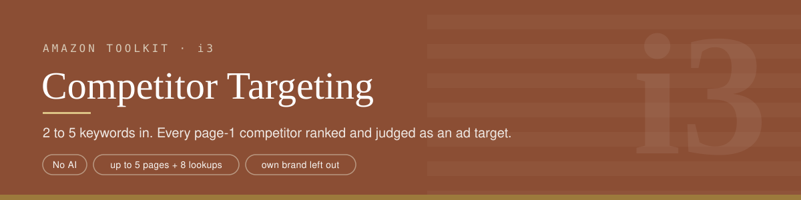
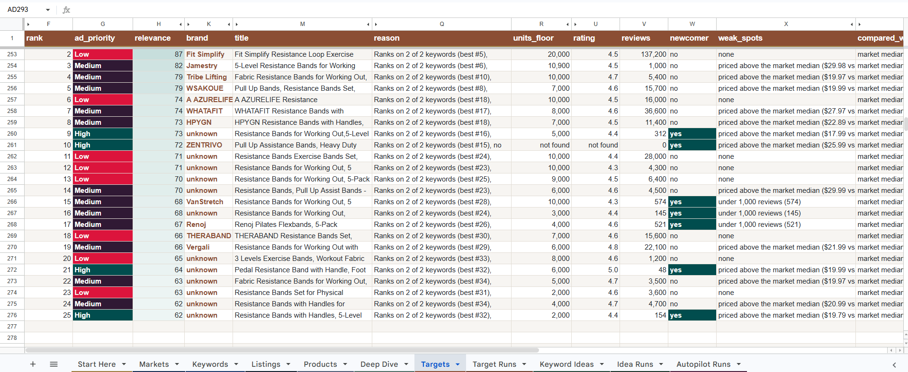

<p align="center">
<a href="../README.md">Toolkit</a> ·
<a href="../i1-market-screener/README.md">i1 Screener</a> ·
<a href="../i2-market-deep-dive/README.md">i2 Deep Dive</a> ·
<b>i3 Targeting</b> ·
<a href="../i4-market-autopilot/README.md">i4 Autopilot</a> ·
<a href="../i5-next-keywords/README.md">i5 Next Keywords</a>
</p>

## What it does

Amazon ads let you show your product on a competitor's listing (ASIN targeting). Which competitors are worth that money? This tool answers it from page 1. You give it 2–5 related keywords and, optionally, your product's price, rating and review count. It:

1. reads page 1 of each keyword, reusing any page saved in the last 24 hours,
2. merges every competitor across those pages into one list,
3. ranks them by **relevance** (how much of your keyword space they hold),
4. looks up the top 8 for BSR, seller and real brand,
5. judges each one as an **ad target**: does it have weak spots your product can beat?

No AI is involved. Every word of every reason comes from a number.

## What it replaces

| By hand | Competitor Targeting |
|---|---|
| Search each keyword, write down the ASINs | Pages read and merged automatically, with the same product counted once |
| Guess which competitors matter most | Relevance 0–100 with its parts written out |
| Compare each one to your product | Weak spots checked against your price, rating and reviews |
| Decide where to put ad money | High, Medium or Low priority, with the reason in one sentence |

## How it works

```mermaid
%%{init: {'theme':'base','themeVariables':{'fontFamily':'Georgia, serif','lineColor':'#9C7A3C','textColor':'#1f2328','edgeLabelBackground':'#f7f5f2'}}}%%
flowchart LR
  A["2–5 keywords<br/>+ your product"] --> B["Pages<br/>new, or reused under 24 h"]
  B --> C["Core c1<br/>variations grouped"]
  C --> D["One competitor,<br/>one row"]
  D --> E["Relevance<br/>50 + 30 + 20"]
  E --> F["Top 8 looked up<br/>BSR · seller · brand"]
  F --> G["Weak spots<br/>→ High · Medium · Low"]
  classDef step fill:#8B4E34,stroke:#9C7A3C,color:#ffffff;
  classDef io fill:#0D1B2A,stroke:#9C7A3C,color:#ffffff;
  class A,G io;
  class B,C,D,E,F step;
```



**One competitor, one row.** These count as one competitor:
- the same ASIN on two pages, or
- the same brand with the same review count (50+) and the same rating.

Its sales are the **highest** badge across pages, never the sum.

**Relevance (0–100)** = keywords it ranks on (**50**) + its best position (**30**) + its share of page sales (**20**, full at 20%).

**Weak spots** against your product:
- priced 5%+ above you
- rated 0.2+ stars below you
- fewer reviews than you
- 15%+ of its ratings are 1–2 stars

**Priority:**
- **High** = relevance 50+ and 2+ weak spots
- **Medium** = 50+ and 1, or 30+ and 2+
- **Low** = the rest

Any field you leave blank falls back on its own: price → the market median, rating → under 4.0 stars, reviews → under 1,000.

**Search cost.** 1 search per keyword not saved in the last 24 h, plus up to 8 product lookups, minus any product looked up in the last 24 h. When nothing new is needed, the SerpApi nodes are skipped entirely.

## What it handles

| Situation | What happens |
|---|---|
| All pages and lookups saved in the last 24 h | **0 searches** (tested live) |
| Some saved, some new | Only the new ones are searched (tested live: 2 searches) |
| Your brand or ASINs entered | Left out of the list and counted in `own_excluded` (tested live). The brand must match exactly, so "Napfun Pro" never hides "Napfun" |
| No product entered | Market-median mode, said so in the notes (tested live) |
| A product lookup fails | The competitor stays listed; `facts_source` says "lookup failed" and why, BSR shows "not found" |
| A keyword fails | The others carry on and the failure is named in the notes. If every keyword fails, the run stops with a clear error |
| More than 5 keywords | The first 5 are used; the rest are named in the notes |
| Junk in the price, rating or review fields ("abc", a 7-star rating) | That field is ignored and named in the notes; the rest of the run goes ahead |
| Brand guessed as a generic word ("Ultra") | Corrected from the product page when it was looked up |
| Any unexpected failure | **e0** emails an alert (tested live) |

## How it was tested

- **Live runs, 17 Oct 2026:**
  - a fresh run (11 searches)
  - a full-reuse run (0 searches)
  - a mixed run (2 searches)
  - an own-brand run
  - a market-median run
  - a forced failure to check the e0 alert
- **Every cell recomputed:** 700 of 700 cells in the Targets rows were recomputed from the Listings and Products tabs and matched.
- **Code review, 18 Oct 2026:** own-brand matching used "starts with" both ways, so a brand like "Napfun Pro" hid every "Napfun" product. Fixed to an exact match, with a regression test in `tests/`.
- **Tested offline only** (simulator on a real sheet export): a failed lookup, a failed keyword, more than 5 keywords, junk numbers, and amazon.co.uk.

## Sample output

17 Oct 2026, amazon.com. Keywords `travel pillow`, `neck pillow`, `airplane pillow`. Your product: $24.99, 4.3 stars, 200 reviews, plus your brand.

**2 searches:** 2 pages reused, 1 new page, 7 lookups reused, 1 new lookup. 82 competitors found, 1 excluded as yours, 25 listed: **3 High, 9 Medium, 13 Low**.

**Most relevant:**

| # | Priority | Relevance | Brand | Keywords | Best pos. | Price | Rating | Reviews | Weak spots |
|---|---|---|---|---|---|---|---|---|---|
| 1 | Low | 100 | napfun | 3 of 3 | #1 | $16.98 | 4.2 | 21,600 | none |
| 2 | Low | 88 | SAIREIDER | 3 of 3 | #2 | $9.99 | 4.6 | 3,100 | none |
| 3 | Medium | 84 | BCOZZY | 3 of 3 | #8 | $49.95 | 4.2 | 33,800 | priced above you |
| 4 | Medium | 84 | Purroch | 3 of 3 | #8 | $29.99 | 4.4 | 1,000 | priced above you |

**Best targets (High):**

| # | Relevance | Brand | Keywords | Price | Rating | Reviews | Weak spots |
|---|---|---|---|---|---|---|---|
| 14 | 65 | *unknown* | 2 of 3 | $39.99 | 3.8 | 508 | priced above you · rated lower (3.8 vs 4.3) |
| 16 | 61 | Maliton | 2 of 3 | $28.99 | 4.1 | 1,300 | priced above you · rated lower (4.1 vs 4.3) |
| 17 | 59 | Cabeau | 2 of 3 | $39.99 | 4.1 | 6,700 | priced above you · rated lower (4.1 vs 4.3) |

Each target's breakdown is written out, for example:

```
keywords 3/3 → 50/50 + best position #8 → 25.8/30 + page sales share 7.8% → 7.8/20
```

The point of this split: the most relevant competitors (napfun, SAIREIDER) are cheaper and well rated, so ads on their listings would lose. The ones worth targeting sit a little lower, priced above you and rated below you.


*The Targets tab from a separate run: `resistance bands` and `exercise bands`, amazon.com.*

## Setup

1. Have the toolkit sheet, `c1 · toolkit-core` and `e0 · error-alerts` ready.
2. **Import from File** → `i3-competitor-targeting.json`.
3. Set your SerpApi credential on **Search Amazon (SerpApi)** and **Look Up Product (SerpApi)**, and your Google credential and sheet on every Sheets node.
4. **Toolkit Core** → `c1 · toolkit-core`. **Settings → Error workflow** → `e0`.
5. **Save**, then **Publish**.

## Known limitations

- **Only page 1.** Competitors further down are invisible.
- **Sales are badge floors,** and "not found" when a listing shows no badge.
- **Only the top 8 are looked up.** Lower ranks keep search-page facts, so their BSR, seller and brand can be "not found" or guessed from the title.
- **Merging relies on matching facts.** Two different products with the same brand, review count and rating would merge. This requires 50+ reviews, so it's rare.
- **No ad costs or conversion data.** Priority says where you have an edge, not what a click costs.
- **Rating and review rules use your numbers as entered.** Wrong input gives wrong weak spots.
