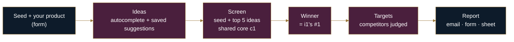

<a href="../README.md">Toolkit</a> ·
<a href="../i1-market-screener/README.md">i1 Screener</a> ·
<a href="../i2-market-deep-dive/README.md">i2 Deep Dive</a> ·
<a href="../i3-competitor-targeting/README.md">i3 Targeting</a> ·
<b>i4 Autopilot</b> ·
<a href="../i5-next-keywords/README.md">i5 Next Keywords</a>

## What it does

You type one seed keyword, like `neck pillow`. Autopilot:

1. asks Amazon's autocomplete what shoppers type after it, and adds the suggestions every earlier search already saved,
2. screens the seed plus the 5 best ideas with the same scoring the [Market Screener](../i1-market-screener/README.md) uses,
3. picks the winner by the screener's own ranking,
4. ranks every competitor in the winning market as an ad target, the way [Competitor Targeting](../i3-competitor-targeting/README.md) does,
5. sends one report: an HTML email, the form's result page, and a row in the **Autopilot Runs** tab.

No AI is involved. Every number in the report comes from Amazon's page 1 and can be recomputed from the **Listings** tab.

## What it replaces

The manual version takes three tools and a spreadsheet:

| By hand | Autopilot |
|---|---|
| Type the seed into Amazon, copy the autocomplete list | 1 autocomplete search |
| Open six search pages, eyeball who sells and how much | Page 1 of each, scored 0–100 with the reasons written out |
| Decide which market looks best | Picked by the screener's ranking; a tie is called out, not hidden |
| Copy competitors into a sheet, look up the strongest ones | Merged across keywords, ranked, top ones looked up |
| Write it up | Emailed report, saved run row |

## How it works

The stages match the sticky notes in the workflow.

**1. Ideas.** One autocomplete search for the seed. Related searches and shopping filters saved by earlier runs are added for free. Ideas with the same words in any order count as one ("neck pillow travel" = "neck pillow for travel"). Ideas that are really a brand name are left out: a brand describes a brand, not a market. This is [Next Keywords](../i5-next-keywords/README.md) code.

**2. Search budget (hard cap 20).** 1 search goes to autocomplete. Pages get what is left after keeping 4 for product lookups. Ideas that don't fit are skipped and named in the report. A page saved in the last 24 hours is reused for 0 searches. A keyword that failed in the last 24 hours is skipped, so you never pay for the same failure twice. You can set a lower budget on the form, down to 6 (1 autocomplete + 1 page + 4 lookups, the smallest run that still says something).

**3. Screen.** Every page goes through the shared core (`c1 · toolkit-core`), the same code i1 and i2 use. Each market gets an opportunity score from 0 to 100 with its parts written out:

| Part | Weight | Full marks when |
|---|---|---|
| Sales to newcomers (under 1,000 reviews, from brands with no established product on the page) | 35 | 20%+ of page-1 sales |
| Brand openness (top 3 brands' share) | 30 | 30% or less |
| Review moat (median reviews) | 25 | 1,000 or less |
| Price room (median price) | 10 | $20+ |
| × Demand (page-1 revenue) | multiplier | $10M+/month = ×1.0, $10K or less = ×0.2 |

Price room and demand are judged in US dollars; amazon.co.uk and amazon.ca prices are converted first (£1 = $1.32, C$1 = $0.70, fixed rates from 2 Oct 2026).

Keywords that share 70%+ of their sales are one market, so "neck pillow travel" and "travel pillow" are scored together.

**4. Winner.** The winner is the screener's #1. If #1 and #2 are closer than run-to-run noise (3 points for a stable market, 8 for moderate, 12 for unstable or first-run), they count as tied. A lower market joins the tie only if it is also within that noise of #1 itself, so a chain of small gaps can't pull in a market far below #1. The higher-confidence market wins the tie; at equal confidence, the higher score wins. The report says which.

**5. Targets.** Only the winner's keyword group feeds this stage. Competitors are merged across its pages: the same ASIN, or the same brand with the same review count and rating, is one competitor, and its sales are the highest badge, never the sum. Relevance = keywords it ranks on (50) + best position (30) + share of page sales (20). The top ones are looked up for BSR, seller and real brand. Each is then judged against your product:

- **Weak spots:** priced 5%+ above you · rated 0.2+ stars below you · fewer reviews than you · 15%+ of ratings are 1–2★
- **High** = relevance 50+ and 2+ weak spots · **Medium** = 50+ and 1, or 30+ and 2+ · **Low** = the rest

Any field you leave blank falls back on its own: price → the market median, rating → under 4.0★, reviews → under 1,000. Your own brand (exact match) or ASINs are left out of the list.

**6. Report.** The same content is written three ways: an HTML email, the form's result page, and one row in **Autopilot Runs**. Markets, Targets, Products, Listings and Keywords get their rows too, so every figure in the report traces back to a listing.

## What it handles

| Situation | What happens |
|---|---|
| Same seed again within 24 h | Reuses the earlier run's exact keyword list and pages. Tested live: **1 search** (autocomplete), identical targets |
| Budget over 20 | Capped at 20, noted in the report |
| Budget under 6 | Raised to 6, noted |
| More ideas than the budget allows | Extra ideas skipped and named |
| A keyword failed in the last 24 h | Skipped, named, not paid for again |
| Autocomplete fails | The seed alone is still screened; the failure is named |
| Every page fails | The run stops with a clear error and **e0** emails an alert |
| Empty seed | Stops with "No seed keyword" before any search |
| Idea led by a brand seen on your saved pages (e.g. Cabeau) | Not screened: a brand isn't a market |
| No product entered | Weak spots measured against the market median, said so in the notes |
| Two runs at once | n8n queues them (`N8N_CONCURRENCY_PRODUCTION_LIMIT=1`), so no rows are lost |

## How it was tested

- **4 live runs** on `neck pillow` (amazon.com, 17 Oct 2026), using 9, 5, 4 and 1 searches as saved pages built up.
- **Every target recomputed:** all 675 cells in the Targets rows were recomputed from the Listings and Products tabs and matched exactly.
- **Repeat run:** the 4th run repeated the 3rd within 24 h. It used 1 search and produced identical targets (all 25 rows).
- **Simulator:** every Code node was run on a real export of the sheet with SerpApi mocked. It covers budget caps, skipped ideas, autocomplete failure, all pages failing, empty seed, no product and the tie rule.

- **Code review, 18 Oct 2026:** ties were chained, so #3 at 56 could join a tie with #1 at 70 (via #2 at 63) and win on higher confidence. Fixed so every tied market must be within noise of #1 itself, with a regression test in `tests/`. The exact own-brand fix from i3 applies here too.

Running out of SerpApi searches mid-run has not been tested live.

## Sample output

Run of 17 Oct 2026, 06:00 PKT. Seed `neck pillow`, amazon.com. Your product: $24.99, 4.3★, 200 reviews.

**Screened** (4 searches: 1 autocomplete, 2 new pages, 4 pages reused, 1 lookup)

| # | Market | Score | Confidence |
|---|---|---|---|
| 1 | travel pillow *(with neck pillow travel, neck pillow airplane)* | **77** | high |
| 2 | neck pillow | 72 | high |
| 3 | neck pillow for car | 42 | high |
| 4 | neck pillow for recliner chair | 35 | high |

**Winner: travel pillow.** Tied on score with "neck pillow" (72, high); picked for the higher score (same high confidence).

| Price range | Bought last month (floor) | Revenue (floor) | Top brand | Newcomer share |
|---|---|---|---|---|
| $16.97–$39.24, median $23.49 | 148,650+ | $3.69M+ | napfun, 15.5% | 15.3% |

**Ad targets** (25 listed: 4 High, 7 Medium, 14 Low; first 6 by relevance)

| # | Priority | Relevance | ASIN | Brand | Price | Rating | Reviews | Weak spots |
|---|---|---|---|---|---|---|---|---|
| 1 | Low | 100 | B07SRRQS5B | napfun | $16.98 | 4.2 | 21,600 | none |
| 2 | Low | 88 | B0CL9SXSBD | SAIREIDER | $9.99 | 4.6 | 3,100 | none |
| 3 | **High** | 85 | B0CFV5LZ3R | SARISUN | $20.99 | 4.0 | 3,700 | rated lower than you (4.0 vs 4.3) · 16% of ratings are 1–2★ |
| 4 | Low | 85 | B0CFF2JG1N | ExploreBliss | $15.99 | 4.2 | 2,300 | none |
| 5 | Medium | 84 | B01DODMU9I | BCOZZY | $49.95 | 4.2 | 33,800 | priced above you ($49.95 vs $24.99) |
| 6 | Low | 79 | B01IEJHJWK | Dot&Dot | $19.99 | 4.2 | 15,700 | none |

The most relevant competitor can be a poor target: napfun ranks on all 3 keywords but has no weak spot against you. Relevance says *where it is*; priority says *whether to aim at it*.

<!-- SCREENSHOT: assets/i4-email.png (the emailed report) -->
<!-- SCREENSHOT: assets/i4-sheet.png (Autopilot Runs + Targets tabs) -->

## Setup

**You need**
- n8n, self-hosted (tested on Community Edition in Docker), started with `-e N8N_CONCURRENCY_PRODUCTION_LIMIT=1` so runs queue instead of colliding
- A [SerpApi](https://serpapi.com) key (the free tier is 250 searches/month)
- A Google Sheet with the toolkit's tabs and headers (see [the toolkit README](../README.md#the-sheet))
- An SMTP login for the email (a Gmail app password works)
- `c1 · toolkit-core` and `e0 · error-alerts` imported first

**Steps**
1. n8n → **Workflows → ⋯ → Import from File** → `i4-market-autopilot.json`
2. Open each **SerpApi** node and pick your SerpApi credential; each **Google Sheets** node → your Google credential and the toolkit sheet; **Email Report** → your SMTP credential, plus the From and To addresses
3. **Toolkit Core** node → choose `c1 · toolkit-core` from the list
4. **⋯ → Settings → Error workflow** → `e0 · error-alerts`
5. **Save**, then **Publish**. The form runs the published version, so every later edit needs both.
6. Open the **Autopilot form** node → copy the Production URL → that's your form.

## Known limitations

- **Sales are floors.** Amazon shows "1K+ bought in past month", so every unit and revenue figure is a minimum, never an estimate of the real number.
- **No search volume, fees, profit, trend or product age.** Page 1 doesn't show them, and the report lists them under *cannot tell*.
- **Brands are guessed from titles** unless a product page was looked up. Targets fix generic first words locally ("Ultra" is not a brand); the Markets tab's `top_brand` doesn't.
- **The combined market's score depends on which keywords get grouped.** A different idea list can group the variants differently.
- **The idea pool grows** as more searches are saved, so a repeat run *after* 24 h can screen a different 5 ideas. Within 24 h it reuses the exact list.
- **Autocomplete can suggest a different product with the same words** ("airplane pillow case").
- **Thin pages are less reliable.** Under 30 listings lowers confidence, and amazon.ca shows fewer sales badges.
- **AI review angles are left out on purpose.** Run [i2 Deep Dive](../i2-market-deep-dive/README.md) on the winner for those.
- **Google OAuth in Testing mode expires weekly.** Reconnect the Sheets credential when runs start failing on the first read.
- Production use would need a paid SerpApi plan: one full run can use 20 of the free tier's 250 monthly searches.
