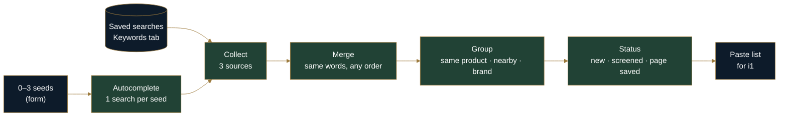
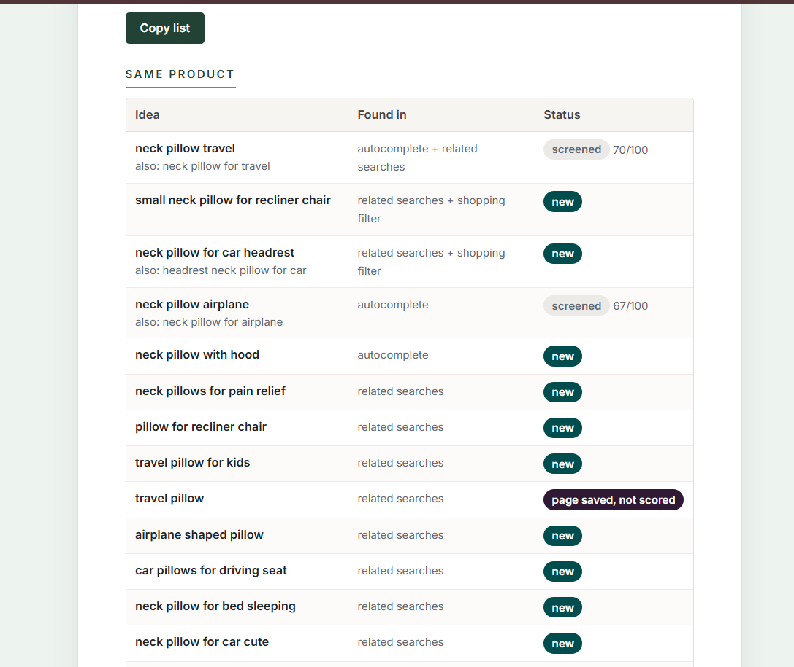

<p align="center">
<a href="../README.md">Toolkit</a> ·
<a href="../i1-market-screener/README.md">i1 Screener</a> ·
<a href="../i2-market-deep-dive/README.md">i2 Deep Dive</a> ·
<a href="../i3-competitor-targeting/README.md">i3 Targeting</a> ·
<a href="../i4-market-autopilot/README.md">i4 Autopilot</a> ·
<b>i5 Next Keywords</b>
</p>

## What it does

The Screener needs keywords to judge. Next Keywords finds them, from Amazon's own suggestions:

1. **Autocomplete** for up to 3 seed keywords: what shoppers type next (1 search per seed).
2. **Related searches** Amazon showed under every keyword you've already searched (saved, free).
3. **Shopping filters** Amazon offered on those pages, joined to their keyword: "with handles" becomes "resistance bands with handles" (saved, free).

It then merges ideas that use the same words in any order, sets brand names aside, marks what you've already screened, and hands you a list to paste straight into the [Market Screener](../i1-market-screener/README.md).

Leave the seeds empty and it works from saved suggestions only, for **0 searches**. No AI is involved.

## What it replaces

| By hand | Next Keywords |
|---|---|
| Type seeds into Amazon, copy the dropdown | 1 autocomplete search per seed |
| Remember the "related searches" from past research | Every one saved and reused for free |
| Spot that "neck pillow travel" is "neck pillow for travel" | Same-words merge |
| Skip brand names, skip what you already checked | Marked automatically |

## How it works



**Merge.** Small linking words ("for", "with", "the"…) and plural endings are ignored, and word order doesn't matter. So `neck pillow travel`, `neck pillow for travel` and `travel neck pillows` are one idea, and the other spellings are kept in `same_as`.

**Group.**
- **same product:** shares the seed's product word ("airplane pillow *for kids*")
- **nearby market:** a different product shoppers look at alongside ("airplane blanket")
- **brand name:** contains a brand seen on your saved pages

**Brand names set aside.** A word counts as a brand only when it leads its titles at least 60% of the time on your saved pages ("JOOLA…", "Lodge…"), or a product page named it. Generic words like "fabric" or "hanging" sit mid-title, so they stay ideas. Colours and words like "ultra", "premium" or "travel" are never brands.

**Status.**
- **new:** never searched
- **screened:** has a score, shown in `last_score`
- **page saved, not scored:** another tool searched it, but no score exists yet

**Paste list.** The top 10 new same-product ideas, one per line, ready for the Screener's form.

## What it handles

| Situation | What happens |
|---|---|
| No seeds | 0 searches; ideas come from saved suggestions only (tested live) |
| More than 3 seeds | The first 3 are used, the rest named |
| A seed too short to mean anything | Skipped and named |
| Autocomplete fails for a seed | The run continues on saved suggestions; the failure is named |
| A seed never searched before | Autocomplete only, with a note that no saved suggestions exist yet |
| Amazon's widget suggestions (not keywords) | Dropped |
| The seed itself | Never listed as an idea |
| amazon.co.uk run | Uses only UK keywords and pages |
| Empty sheet | A clean "nothing found" result, no crash |

## How it was tested

- **Live runs, 17 Oct 2026:**
  - 2 seeds (`neck pillow`, `airplane pillow`): 2 searches, 24 ideas
  - no seeds: 0 searches, twice, with 200 ideas and then 258 as more saved searches built up
- **Every cell recomputed:** 1,425 of 1,425 output cells were recomputed from the sheet and matched.
- **Simulator** on a real sheet export, 17 checks: brand detection (Cabeau set aside, product words never treated as brands), same-words merge, a failed autocomplete, UK isolation, an empty sheet, and identical output for identical input.

## Sample output

17 Oct 2026, amazon.com, seeds `neck pillow` and `airplane pillow`. **2 searches**, 20 autocomplete suggestions, 24 ideas: 20 same product, 4 nearby market, 0 brand.

| # | Idea | Group | Sources | Status | Also seen as |
|---|---|---|---|---|---|
| 1 | airplane pillow for kids | same product | autocomplete + related searches + shopping filter | new | kids airplane pillow |
| 2 | airplane pillow neck support | same product | autocomplete + shopping filter | new | neck support airplane pillow |
| 3 | airplane pillow with eye mask | same product | autocomplete + shopping filter | new | eye mask airplane pillow |
| 5 | neck pillow airplane | same product | autocomplete | new | neck pillow for airplane |
| 8 | neck pillow travel | same product | autocomplete | **page saved, not scored** | neck pillow for travel |
| 21 | airplane travel essentials | nearby market | related searches | new | |
| 23 | airplane blanket | nearby market | related searches | new | |

**Ready to paste into i1:**

```
airplane pillow for kids
airplane pillow neck support
airplane pillow with eye mask
airplane pillow for long flight
neck pillow airplane
neck pillow for sleeping
airplane pillow and blanket set
airplane pillow inflatable
neck pillow for bed
airplane pillow blanket
```

Several of these were then screened by [Autopilot](../i4-market-autopilot/README.md) on the same day.


*Result page from a separate run: seed `neck pillow` only, 18 Oct 2026.*

## Setup

1. Have the toolkit sheet and `e0 · error-alerts` ready. i5 doesn't call the core.
2. **Import from File** → `i5-next-keywords.json`.
3. Set your SerpApi credential on **Amazon Autocomplete (SerpApi)**, and your Google credential and sheet on the 3 Read nodes and 2 Save nodes.
4. **Settings → Error workflow** → `e0`.
5. **Save**, then **Publish**.

## Known limitations

- **No search volume.** An idea being suggested doesn't mean many people search it. i1 is where it gets judged.
- **Autocomplete can suggest a different product with the same words** ("airplane pillow case" is a pillowcase, not a pillow).
- **Brand detection is a title-position rule.** Rare false positives exist ("rgb" once looked like a brand).
- **The free idea pool grows with your history.** No-seed runs are only as good as what you've already searched.
